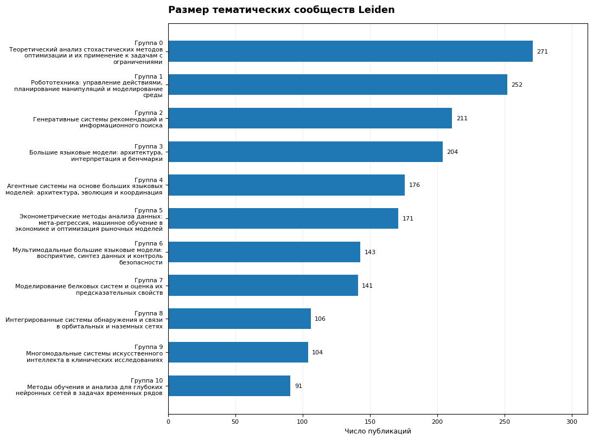
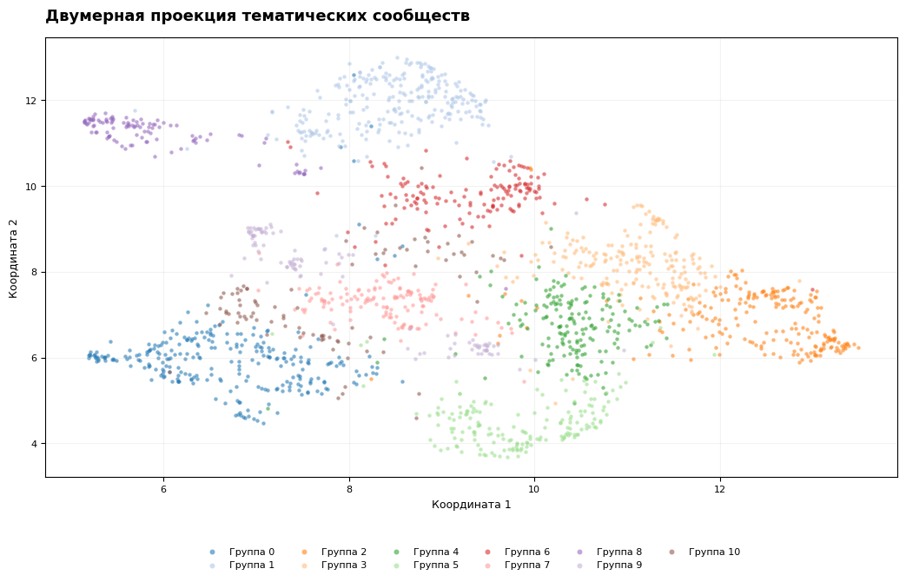
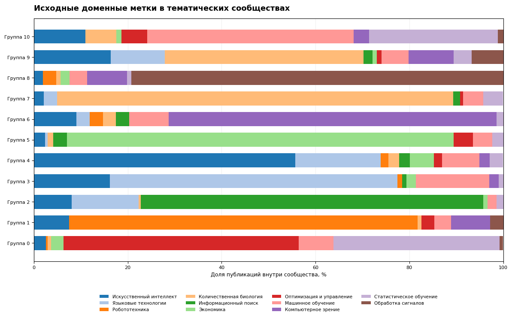
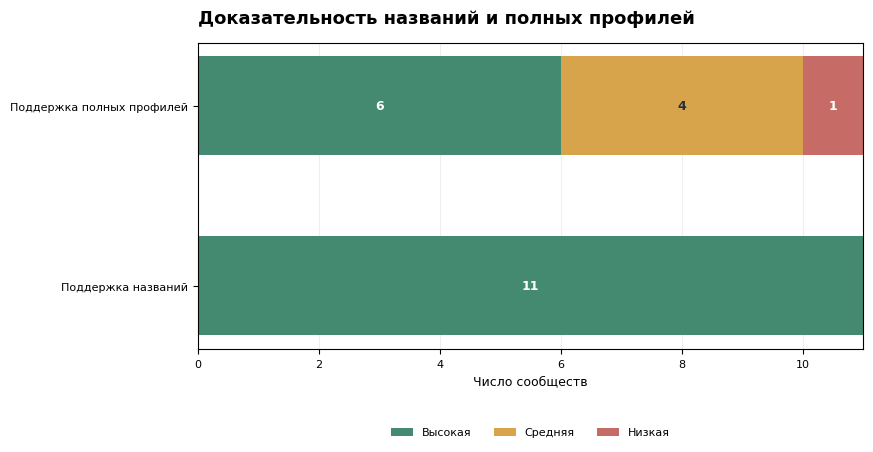

# Scientific Clustering

Проект для обработки корпуса научных публикаций и выделения тематических сообществ. В нём есть подготовка документов, построение SPECTER-векторов, графовая кластеризация, статистическое описание групп и отдельный этап семантического именования.

В этой сборке сохранены результаты последнего анализа корпуса из 1870 публикаций. Повторно строить граф и запускать кластеризацию для просмотра этих результатов не требуется.

## 1. Что получилось

Для корпуса были подготовлены векторы `allenai-specter` размерности 768 и взвешенный граф косинусных соседей. В сохранённом запуске граф содержит 1870 вершин и 21 202 ребра; он состоит из одной компоненты связности.

Затем на этом графе был выполнен поиск сообществ Leiden. Число сообществ не задавалось заранее: оно получилось в ходе проверки нескольких значений resolution. Для сохранённого результата выбрано `resolution = 1.25`, итог — 11 сообществ без шума.

В сохранённом графовом запуске также лежит исходное разбиение Louvain на 10 групп. Это отдельный результат другого алгоритма. Семантическая карта строится по разбиению Leiden на 11 сообществ; разница в количестве групп ожидаема и не означает потерю документов.

Основные показатели выбранного разбиения:

| Показатель | Значение |
|---|---:|
| Публикации | 1870 |
| Вершины графа | 1870 |
| Рёбра графа | 21 202 |
| Компоненты связности | 1 |
| Сообщества Leiden | 11 |
| Resolution | 1,25 |
| Модульность | 0,6328 |
| Средний ARI между повторными запусками | 0,9000 |
| Минимальный ARI между повторными запусками | 0,8651 |
| Число повторов при оценке устойчивости | 3 |

ARI использовался для оценки воспроизводимости разбиения при повторных запусках. Модульность характеризует структуру связей внутри найденных сообществ. Силуэт рассчитан в пространстве векторов и не рассматривается здесь как доказательство качества графового разбиения. При этом в исходном переборе resolution он участвовал в техническом ранжировании кандидатов: итоговый score складывался из рангов устойчивости ARI и cosine silhouette с весами 0,5 и 0,5. Поэтому выбор `1.25` следует понимать как результат зафиксированной эвристики перебора, а не как универсально оптимальное значение.

### Тематические сообщества

| ID | Публикаций | Название |
|---:|---:|---|
| 0 | 271 | Теоретический анализ стохастических методов оптимизации и их применение к задачам с ограничениями |
| 1 | 252 | Робототехника: управление действиями, планирование манипуляций и моделирование среды |
| 2 | 211 | Генеративные системы рекомендаций и информационного поиска |
| 3 | 204 | Большие языковые модели: архитектура, интерпретация и бенчмарки |
| 4 | 176 | Агентные системы на основе больших языковых моделей: архитектура, эволюция и координация |
| 5 | 171 | Эконометрические методы анализа данных: мета-регрессия, машинное обучение в экономике и оптимизация рыночных моделей |
| 6 | 143 | Мультимодальные большие языковые модели: восприятие, синтез данных и контроль безопасности |
| 7 | 141 | Моделирование белковых систем и оценка их предсказательных свойств |
| 8 | 106 | Интегрированные системы обнаружения и связи в орбитальных и наземных сетях |
| 9 | 104 | Многомодальные системы искусственного интеллекта в клинических исследованиях |
| 10 | 91 | Методы обучения и анализа для глубоких нейронных сетей в задачах временных рядов |

Названия сформированы локальной моделью Qwen 3.5 4B через Ollama и затем прошли отдельную проверку по публикациям. У всех 11 названий в итоговом CSV стоит высокий уровень поддержки; на каждое название приведено четыре или пять подтверждающих заголовков.

При этом проверка полного описания строже проверки короткого названия. В текущем результате все 11 полных профилей помечены `review_required`: в них остались отдельные утверждения о методах или подтемах, которые требуют ручной проверки. Это не означает, что сами названия не подтверждены. По оценке поддержки профиля шесть групп имеют высокий уровень, четыре — средний, одна — низкий.

### Визуализации сохранённого результата

**Размеры сообществ**



**Расположение публикаций на двумерной проекции**



Координаты на карте нужны для визуального просмотра групп. Они не являются дополнительным доказательством качества разбиения.

**Исходные доменные метки внутри сообществ**



Доменные метки используются как справочная характеристика корпуса. Это не эталонная тематическая разметка.

**Отдельная оценка названий и полных профилей**



## 2. Состав проекта

```text
scientific-clustering/
├── artifacts/
│   ├── cache/                 локальный кэш аннотаций
│   ├── embeddings/            SPECTER-векторы и manifest
│   ├── runs/                  сохранённый графовый запуск
│   └── figures/               графики для отчёта
├── dashboard/                 основная панель Streamlit
├── reports/                    отчёты и результаты тематического анализа
├── src/
│   └── sciintel/
│       ├── semantic/           поиск сообществ и семантическое именование
│       ├── cli.py              командная строка
│       ├── clustering.py       DBSCAN и HDBSCAN
│       ├── graph_clustering.py построение графа и Louvain
│       ├── topic_naming.py     статистическое формирование названий
│       └── topic_understanding.py анализ подтем и профилей
├── tests/                      тесты проекта
├── .env.example                пример локальных настроек
├── START.bat                   запуск и установка для Windows
├── pyproject.toml              описание Python-пакета
└── requirements.txt            единый список библиотек
```

`topic_naming.py` и `topic_understanding.py` оставлены в проекте, потому что основная панель использует их для статистического анализа терминов и внутренних подтем. Семантические модули собраны в `src/sciintel/semantic`. Отдельные скрипты старого сравнения Louvain и Leiden и его stage-2 аудит удалены: они не участвуют в текущем сценарии и не вызываются панелью.

## 3. Установка на Windows

Требуется Windows 11 x64 и Python 3.12. Для вычислений на видеокарте нужна совместимая установка драйвера NVIDIA и CUDA-сборка PyTorch. Проект также может выполнять поддерживаемые операции на CPU.

1. Распакуйте архив в рабочую папку.
2. Скопируйте из предыдущей версии проекта всю папку `data` в корень этой сборки. В ней должны находиться `data/silab.sqlite3` и `data/processed`.
3. Не удаляйте и не заменяйте папку `artifacts`: в ней лежат векторы, графовый запуск и результаты тематического анализа.
4. При первом запуске дважды щёлкните `START.bat`. Выберите установку и запуск. Скрипт создаст `.venv`, установит библиотеки из одного файла `requirements.txt` и установит проект.

Для ручной установки из PowerShell в корне проекта:

```powershell
py -3.12 -m venv .venv
.\.venv\Scripts\python.exe -m pip install --upgrade pip
.\.venv\Scripts\python.exe -m pip install -r requirements.txt
.\.venv\Scripts\python.exe -m pip install --no-deps -e .
Copy-Item .env.example .env
```

Файл `.env` создаётся локально и не входит в архив. При необходимости измените в нём пути к папкам и параметры подключения к Neo4j.

## 4. Запуск

Запуск через меню:

- `START.bat` — открыть меню;
- `START.bat dashboard` — основная аналитическая панель;
- `START.bat explorer` — карта тематических сообществ;
- `START.bat setup` — повторная установка или восстановление окружения.

Проверить конфигурацию Python и CUDA можно так:

```powershell
.\.venv\Scripts\python.exe -m sciintel.cli doctor
```

Основные команды обработки корпуса:

```powershell
# Инициализация базы и папок
.\.venv\Scripts\python.exe -m sciintel.cli init

# Обработка PDF, DOC, DOCX, RTF, TXT и Markdown из data/inbox
.\.venv\Scripts\python.exe -m sciintel.cli ingest

# Извлечение ключевых фраз
.\.venv\Scripts\python.exe -m sciintel.cli keywords

# Построение или обновление SPECTER-векторов
.\.venv\Scripts\python.exe -m sciintel.cli embed --device cuda --batch-size 16

# HDBSCAN с UMAP-проекцией
.\.venv\Scripts\python.exe -m sciintel.cli hdbscan --device cuda --reduction umap --umap-components 10 --umap-neighbors 30 --umap-min-dist 0.0 --min-cluster-size 12 --min-samples 2 --selection eom

# Построение kNN-графа и поиск сообществ Louvain
.\.venv\Scripts\python.exe -m sciintel.cli graph-cluster --device cuda --k 15 --min-similarity 0.35 --resolution 1.0 --min-community-size 5
```

## 5. Семантический анализ без повторной кластеризации

Для нового поиска сообществ Leiden по существующему графу:

```powershell
.\.venv\Scripts\python.exe -m sciintel.semantic.auto_topic_discovery --root . --run-id latest --abstract-source local
```

Чтобы обновить названия и описания уже найденных сообществ, не меняя назначения публикаций:

```powershell
.\.venv\Scripts\python.exe -m sciintel.semantic.label_existing_topics `
    --root . `
    --run-id latest `
    --source-result latest `
    --ollama-model qwen3.5:4b `
    --abstract-source local
```

Для семантической разметки требуется установленный Ollama и загруженная модель `qwen3.5:4b`. Режим `--abstract-source local` использует локальную SQLite-базу и не обращается к OpenAlex или Crossref за новыми аннотациями.

В сохранённом результате аннотации найдены для 1870 из 1870 публикаций в SQLite. В папке `data/processed` также обнаружены 1870 текстовых файлов. При последнем именовании модель использовала аннотации из SQLite; повторно читать полные тексты не потребовалось (`processed_text_files_read = 0`). Поэтому покрытие аннотациями 100% не следует трактовать как чтение моделью всех полных текстов.

## 6. Результаты и файлы

Основной графовый запуск:

```text
artifacts/runs/20261120_015622_graph_b63e68/
```

Семантические результаты лежат в:

```text
reports/auto_topic_discovery/20261120_015622_graph_b63e68/
```

Файл `latest.json` указывает на последний семантический результат. В папке результата находятся:

- `topic_profiles.csv` — названия, размеры и описания сообществ;
- `document_assignments.csv` — назначение каждой публикации;
- `projection_2d.csv` — координаты для карты;
- `paper_evidence.csv` — аннотации и сведения об источниках;
- `topic_label_generation.json` — этапы генерации и проверки;
- `summary.json` — параметры и статистика запуска;
- `REPORT_LLM_LABELS_RU.md` — краткий отчёт по результату.

Графики, включённые в этот README, находятся в `artifacts/figures`.

## 7. Тесты

Тесты собраны в одной папке `tests`:

```powershell
.\.venv\Scripts\python.exe -m pytest tests -q
```

## 8. Что не входит в архив

В архив намеренно не включены исходные PDF, `data/processed`, SQLite-база и файл `.env`. Корпус нужно перенести из предыдущей рабочей папки. SPECTER-векторы, сохранённый граф, кэш аннотаций и результаты последнего анализа уже включены в `artifacts` и `reports`.

Файл `docker-compose.yml` оставлен для дополнительного экспорта данных в Neo4j. Для этого сервиса нужно отдельно заполнить параметры `NEO4J_*` в локальном `.env`; для работы основной панели и просмотра сохранённых результатов Docker не требуется.

# Патч: лингвистический анализ и позиционная индексация

Патч добавляет к существующему `scientific-clustering` отдельный модуль обработки естественного языка. Он не заменяет проект и не затрагивает сохранённые SPECTER-векторы, графы, результаты Leiden/Louvain, семантические профили и назначения документов.

## Что добавлено

- Конвертация PDF, DOC, DOCX, RTF, TXT и Markdown в UTF-8 Markdown.
- Морфологический анализ, POS-теги, лемматизация и синтаксические зависимости на spaCy.
- Английская модель `en_core_web_sm` и русская `ru_core_news_sm`; язык можно определять автоматически.
- Разбиение на предложения и сохранение пунктуации как отдельных токенов.
- Индекс предложений, токенов, лемм, предметных понятий и вхождений.
- Привязка каждого вхождения к документу, предложению, диапазону токенов и символьным позициям.
- SQLite FTS5 для поиска по предложениям и понятиям.
- CLI-команды `linguistic-index` и `linguistic-search`.
- Страница «Лингвистический анализ» в Streamlit.

## Установка патча

1. Распакуйте ZIP во временную папку.
2. Откройте PowerShell в корне существующего проекта `scientific-clustering`.
3. Запустите установщик, указав путь к распакованному `apply_patch.py`:

```powershell
.\INSTALL_PATCH.ps1 -ProjectRoot "C:\путь\к\scientific-clustering"
```

Либо напрямую через Python:

```powershell
py -3.12 "C:\путь\к\патчу\apply_patch.py" --project-root "C:\путь\к\scientific-clustering"
```

Установщик проверяет структуру проекта, делает резервные копии изменяемых файлов в `.patch-backups/linguistic_<дата-время>` и добавляет новые файлы. Если ожидаемый участок кода не найден или уже существует `src/sciintel/linguistic`, установка остановится вместо перезаписи неизвестного содержимого.

## Зависимости и модели

```powershell
.\.venv\Scripts\python.exe -m pip install -r requirements.txt
.\.venv\Scripts\python.exe -m pip install --no-deps -e .
.\scripts\install_linguistic_models.ps1
```

Установка обеих моделей требует доступа к интернету. Если нужна только одна модель:

```powershell
.\scripts\install_linguistic_models.ps1 -EnglishOnly
.\scripts\install_linguistic_models.ps1 -RussianOnly
```

Для старого бинарного формата DOC дополнительно нужен LibreOffice с командой `soffice` в PATH. DOCX и RTF обрабатываются Python-библиотеками.

## Запуск

Построить индекс по всем документам, автоматически определяя преобладающий язык:

```powershell
.\.venv\Scripts\python.exe -m sciintel.cli linguistic-index
```

Явно указать язык и принудительно переиндексировать:

```powershell
.\.venv\Scripts\python.exe -m sciintel.cli linguistic-index --language en --force
.\.venv\Scripts\python.exe -m sciintel.cli linguistic-index --language ru --force
```

Поиск по предложениям, словам/леммам и предметным понятиям:

```powershell
.\.venv\Scripts\python.exe -m sciintel.cli linguistic-search "neural network" --kind sentences
.\.venv\Scripts\python.exe -m sciintel.cli linguistic-search "neural network" --kind concepts
```

Также доступна страница «Лингвистический анализ» в Streamlit.

## Структура индекса

| Таблица | Содержание |
|---|---|
| `linguistic_documents` | Язык, модель, исходный и Markdown-путь |
| `sentences` | Предложения и символьные интервалы |
| `tokens` | Токены, леммы, POS, морфологические признаки (Case, Number, Tense и др.), синтаксические зависимости, позиции, пунктуация |
| `concepts` | Канонические лемматизированные формы понятий |
| `concept_occurrences` | Связь понятия с документом, предложением, диапазоном токенов и символов |
| `sentence_fts` | Полнотекстовый индекс предложений |
| `concept_fts` | Полнотекстовый индекс нормализованных понятий |

`char_start` и `char_end` — нулевые смещения в сохранённом Markdown; правая граница не включается. Пунктуация не отбрасывается, а сохраняется как токены `PUNCT`.

## Ограничения и корректная интерпретация

- Извлечение понятий основано на noun chunks (при наличии синтаксического парсера) либо последовательностях прилагательных и именных частей речи. Это кандидаты в термины, а не готовая онтология предметной области.
- Автоматическое определение языка выбирает язык по преобладанию кириллических или латинских букв в документе. Для смешанных корпусов и отдельных документов можно явно задавать `--language`.
- PDF-конвертация извлекает текстовый слой. Для сканированных PDF без OCR текст может отсутствовать или быть неполным.
- Конвертация DOC зависит от установленного LibreOffice.
- Символьные позиции относятся к Markdown-тексту после конвертации, а не к байтам PDF/DOC и не к координатам страницы.
- Модели spaCy необходимо скачать отдельно; сами веса языковых моделей в ZIP не включены.
